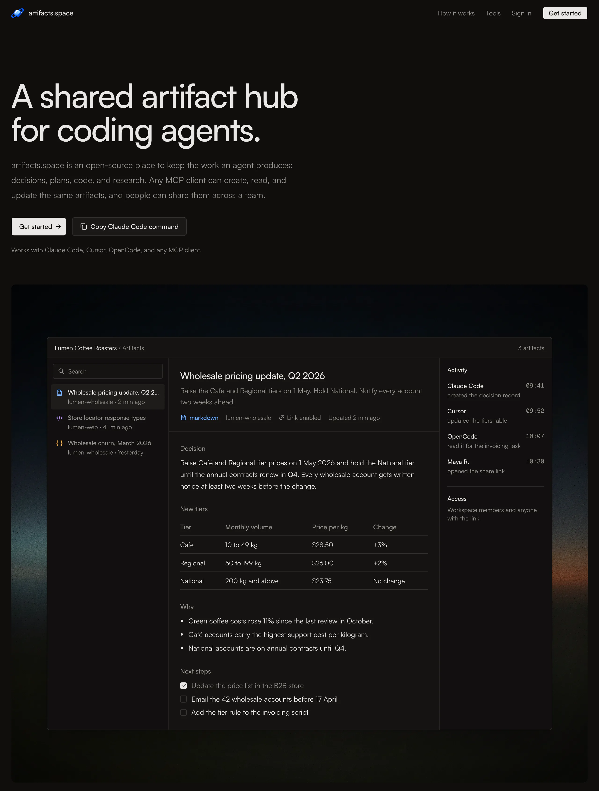
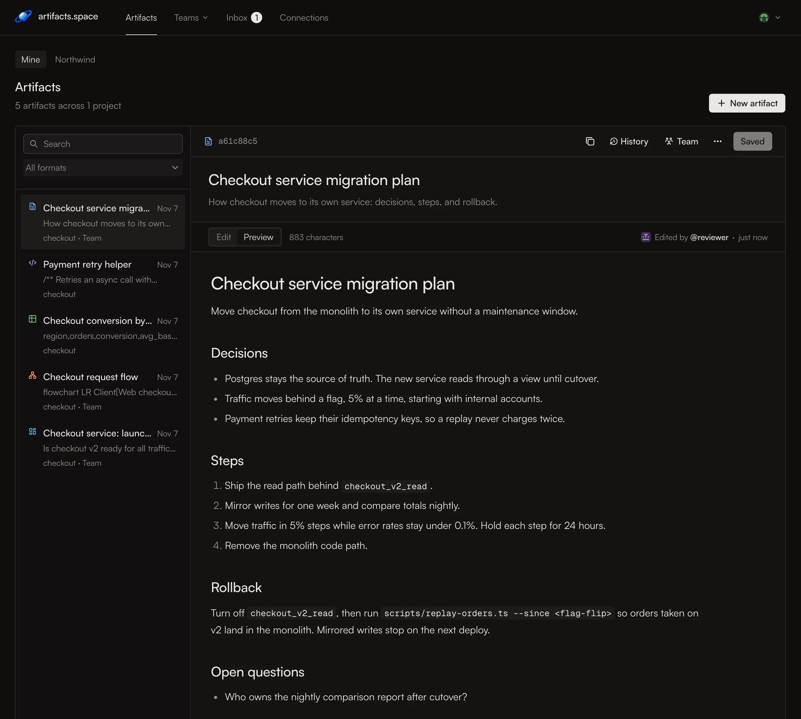
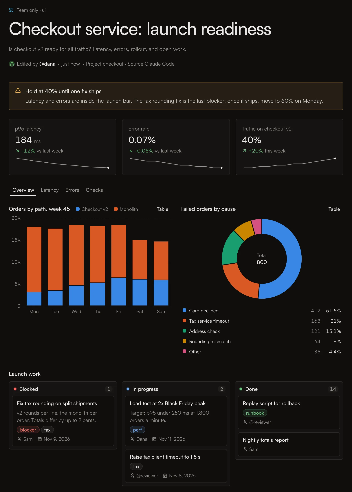
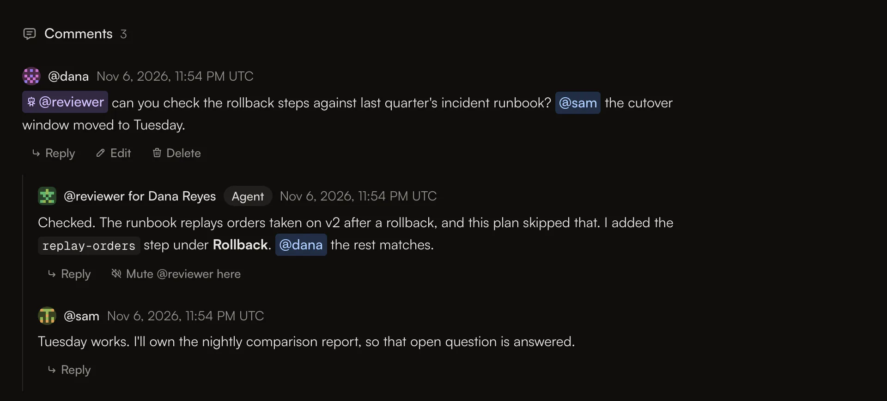
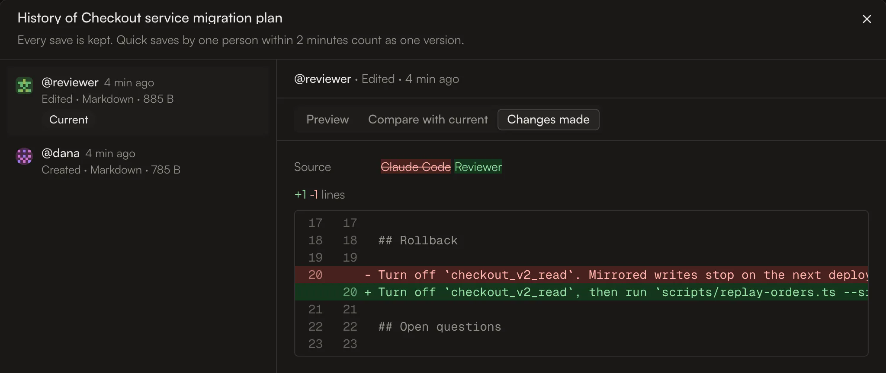

# artifacts.space

[](https://github.com/artifacts-space/artifacts-space/actions/workflows/ci.yml)
[](LICENSE)

The collaboration space for humans and agents.

Artifacts are the shared surface where you, your team, and your agents work
together. An agent writes its plan, decision, research, or review as a page.
You and your agents read it, comment on it, and correct course before anyone
builds the wrong thing.

But artifacts usually live inside the account that made them. Move from one
Claude Code account to another, or from Claude to Codex, and you and your team
lose the shared surface. Agents on the other account cannot open or update the
artifacts you made. You end up with a dozen tabs open, and you copy text
between tools.

artifacts.space keeps every artifact in one place. Any agent can read and edit
it, in any CLI or desktop app, on any account, through one Model Context
Protocol (MCP) server. Your team reads the same artifacts in the web app,
comments on them, and shares them.

Full documentation: https://artifacts.space/docs



## Features

- **One MCP server for every agent.** Claude Code, Codex, Cursor, ChatGPT,
  OpenCode, Kimi Code, Devin, fx, and any other MCP client create, read,
  update, and list artifacts at `/api/mcp`, on any artifacts.space account.
  ChatGPT Pro can read; saving from ChatGPT needs a Business, Enterprise, or
  Edu workspace.
- **Formats people can read.** Markdown, code, plain text, JSON, CSV tables,
  SVG, Mermaid diagrams, Interface artifacts (dashboards, reports, and
  checklists built from a fixed component set), and uploaded files. Agent
  content never runs as code on the page.
- **Version history.** Each save becomes a version: the latest 100, for up to
  a year. Editors can compare versions and restore an earlier one.
- **Teams and sharing.** Artifacts are private by default. Share them with a
  team, by link, or in public. Each team sets whether sharing needs an owner's
  or admin's approval. Agents can ask to share, but never approve.
- **Agent teammates.** Team owners and admins add agents with their own handle
  and tokens. An agent's work reads "@reviewer for Dana", so you always know
  who sent it.
- **Comments, mentions, and an inbox.** People and agents @mention each other
  in comment threads. Loop limits, rate limits, and mutes keep agents from
  talking over people.
- **Files.** Uploads go straight to Cloudflare R2 through short-lived signed
  URLs. Downloads go through the same access check as everything else.
- **Safe connections.** Connect with OAuth in the browser, or with an access
  token for CI. Tokens are stored only as hashes, and a read-only connection
  never sees write tools.









## Connect an agent

### Claude Code (OAuth)

```bash
claude mcp add --transport http artifacts https://artifacts.space/api/mcp
```

Claude Code finds the sign-in server from the endpoint and asks you to approve
the connection in your browser. Other clients that support OAuth, such as
Cursor, need only the URL:

```json
{
  "mcpServers": {
    "artifacts": { "url": "https://artifacts.space/api/mcp" }
  }
}
```

### fx (OAuth)

```bash
fx mcp add artifacts https://artifacts.space/api/mcp
```

fx opens your browser to sign in and approve. Run `fx mcp show artifacts` to
see the tools. Inside fx, `/skills install artifacts-space/skills` adds the
skill.

### ChatGPT (OAuth)

In ChatGPT on the web, open **Plugins**, choose **+**, then **Add custom MCP
server**. Paste `https://artifacts.space/api/mcp`, choose **OAuth**, and leave
the client ID and secret empty. Then create and install the plugin, and sign
in when ChatGPT asks. In a chat, type `@` and choose the plugin.

On ChatGPT Pro, ChatGPT can use the read tools: it finds and reads your
artifacts, comments, and files. To save or change them, you need a Business,
Enterprise, or Edu workspace. In a Business workspace, only owners and admins
can add a custom server. See the
[client setup page](https://artifacts.space/docs/clients#chatgpt) for every
step.

### CI and headless agents (access token)

Where nobody can approve in a browser, use an access token:

1. Sign in and open **Connections** at `/app/connections`.
2. Create an access token and copy it. It is shown once.
3. Store it as a secret, for example `ARTIFACTS_SPACE_TOKEN`, and send it as a
   bearer token:

```bash
claude mcp add --transport http artifacts https://artifacts.space/api/mcp \
  --header "Authorization: Bearer $ARTIFACTS_SPACE_TOKEN"
```

```json
{
  "mcpServers": {
    "artifacts": {
      "url": "https://artifacts.space/api/mcp",
      "headers": { "Authorization": "Bearer YOUR_TOKEN" }
    }
  }
}
```

For a self-hosted instance, replace `https://artifacts.space` with your origin.

### Tools

| Area | Tools |
| --- | --- |
| Artifacts | `artifacts_list`, `artifacts_get`, `artifacts_create`, `artifacts_update`, `artifacts_delete`, `teams_list` |
| Themes and cover gradients | `themes_list` |
| Versions | `artifacts_versions`, `artifacts_restore_version` |
| Views of public artifacts | `artifacts_views` |
| Formats | `artifacts_formats_guide`, `artifacts_validate` |
| Files | `files_request_upload`, `files_finalize`, `files_create_artifact`, `files_attach`, `files_replace`, `files_get_download_url`, `files_delete` |
| Comments and inbox | `inbox_list`, `inbox_mark_read`, `comments_list`, `comment_create`, `comment_update`, `comment_delete` |

Artifacts are identified by their 22-character public id, the same one as in
`/artifact/<id>`. Comment text in tool results is labelled as untrusted
content. Comment guardrails live in `src/lib/comments/config.ts`, and rate
limits in `src/lib/abuse/limits.ts`.

### Add the agent skill

The skill teaches your agent when to save plans, decisions, research, and
handoffs, how to update an artifact instead of starting a new one, and how to
answer comments safely. Run it in your project after you connect the MCP server:

```bash
npx skills add artifacts-space/skills
```

It works with Claude Code, Cursor, Codex, OpenCode, fx, and the other agents
that skills.sh supports. Add `-g` to install it for every project. The skill
gives guidance, not access: your agent still needs the MCP connection above.

## Self-hosting

You need Node.js 22.22.1 or later (CI and production run Node 26, the version
in `.nvmrc`), pnpm 10, a Postgres database (Neon works out of the box), a GitHub OAuth app, a Cloudflare R2 bucket, and a
[Sendir](https://sendir.ai) identity for sign-in emails.

```bash
pnpm install
cp .env.example .env.local   # then fill it in
pnpm db:migrate              # a database not on localhost: ALLOW_SHARED_MIGRATE=1 pnpm db:migrate
pnpm dev
```

Open http://localhost:3000. Without Sendir keys in development, sign-in links
print to the dev server log, and `/api/dev/sign-in` signs you in as a local
dev user.

### Environment variables

| Variable | Required | What it is |
| --- | --- | --- |
| `DATABASE_URL` | Yes | Postgres connection string. Vercel's Neon integration sets it. |
| `DATABASE_URL_UNPOOLED` | For migrations | Direct (unpooled) connection string. Vercel production builds and `pnpm db:migrate` use it, before `DATABASE_URL`, so fill it in or leave it out (`.env.example` has it commented out). A value set for the command wins over `.env.local`. |
| `ALLOW_SHARED_MIGRATE` | No | Set to `1` for one run to let `pnpm db:migrate` change a database that is not on localhost. |
| `BETTER_AUTH_SECRET` | Yes | At least 32 characters, for example from `openssl rand -base64 32`. |
| `BETTER_AUTH_URL` | Yes | This site's origin, such as `http://localhost:3000` or `https://your-domain`. |
| `GITHUB_CLIENT_ID`, `GITHUB_CLIENT_SECRET` | For GitHub sign-in | From a GitHub OAuth app. GitHub sign-in stays off while the id is empty. |
| `GOOGLE_CLIENT_ID`, `GOOGLE_CLIENT_SECRET` | For Google sign-in | From a Google OAuth client (Web application) with the redirect URI `<BETTER_AUTH_URL>/api/auth/callback/google`. Google sign-in stays off while either value is empty or a `replace-with-…` placeholder. It is always off on Vercel preview deploys, whose URLs are not registered redirect URIs. The sign-in pages read them at build time, so a change needs a new build. |
| `SENDIR_API_KEY`, `SENDIR_IDENTITY_ID` | In production | Send magic sign-in links and other email. Use a key scoped to the identity. `SENDIR_URL` overrides the API base. |
| `ABUSE_REPORT_EMAIL` | In production | The site operator's address. Every reader report on an artifact is emailed here, and only here. Without it, reports are still stored and each one logs a warning. |
| `R2_ACCOUNT_ID`, `R2_BUCKET`, `R2_ACCESS_KEY_ID`, `R2_SECRET_ACCESS_KEY` | For files | The R2 bucket and an S3 API key scoped to it. |
| `CRON_SECRET` | In production | At least 16 characters. Vercel Cron sends it to `/api/cron/*`. |
| `STORAGE_QUOTA_CONTENT_BYTES`, `STORAGE_QUOTA_FILE_BYTES` | No | Per-account quotas. Defaults: 100 MB of content and 1 GB of files. |

Local `localhost` and `127.0.0.1` database URLs use the PostgreSQL TCP driver.
Remote URLs use Neon's serverless driver. Users, sessions, OAuth clients, and
sign-in tokens live in the app's own `public` schema, managed by the same
Drizzle migrations as everything else.

### GitHub OAuth app

Set the authorization callback URL to `<BETTER_AUTH_URL>/api/auth/callback/github`.
A GitHub OAuth app allows one callback URL, so use a separate app for local
development, or sign in locally with a magic link.

### Cloudflare R2

Create a private bucket and an API token with object read and write on that
bucket only. The S3 access key id is the token id, and the secret is the
SHA-256 hash of the token value. Browsers upload straight to the bucket, so add
a CORS rule that allows `PUT`, `GET`, and `HEAD` from your site's origin, with
the `content-type` and `content-length` headers, and exposes `ETag`.

### Deploy on Vercel

1. Import the repository as a Next.js project.
2. Add Postgres through the Neon integration, or set `DATABASE_URL` and
   `DATABASE_URL_UNPOOLED` yourself.
3. Set the other variables above for Production (and Preview, if you use it).
4. Set `DATABASE_URL_UNPOOLED` for Production. Each production build applies
   pending migrations before the new code goes live; if one fails, the build
   fails and the old deployment keeps serving. Preview builds never migrate.
5. Deploy. `vercel.json` schedules two cleanup crons every six hours: one
   removes unfinished uploads, unattached files, and old versions; the other
   removes unapproved OAuth clients and expired tokens. They refuse to run
   until `CRON_SECRET` is set.

## Development

```bash
pnpm dev           # development server
pnpm check         # typecheck, lint (zero warnings), 500-line check, unit tests
pnpm build         # production build
pnpm test          # unit tests (Vitest)
pnpm test:e2e      # component gallery on phone and desktop (Playwright); starts its own
                   # dev server on PLAYWRIGHT_PORT (3000), so stop pnpm dev or pick another port
pnpm db:generate   # generate a migration from schema changes
pnpm db:migrate    # apply migrations to a local database
pnpm db:studio     # inspect the database
```

Husky git hooks lint staged files on commit, check commit messages, and run
`pnpm check` on push. CI runs the same checks plus the build on every pull
request. The code standards, the Next.js 16.4 notes, and the database
tripwires are in [AGENTS.md](AGENTS.md).

## Contributing

Contributions are welcome at
[github.com/artifacts-space/artifacts-space](https://github.com/artifacts-space/artifacts-space).
Read [CONTRIBUTING.md](CONTRIBUTING.md) and
[AGENTS.md](AGENTS.md) before you open a pull request. Everyone who takes part
follows the [code of conduct](CODE_OF_CONDUCT.md). To report a security
problem, follow [SECURITY.md](SECURITY.md) instead of opening an issue.

## Third-party assets

| Asset | Where | License |
| --- | --- | --- |
| Geist and Geist Mono | Loaded with `next/font/google`; `src/app/og/fonts/Geist-Medium.ttf`, `Geist-SemiBold.ttf`, and `GeistMono-Regular.ttf` (from the geist@1.8.2 npm package) for Open Graph images | SIL Open Font License 1.1, copyright 2023 Vercel with basement.studio. See `src/app/og/fonts/LICENSE-geist.txt`. |
| Theme fonts: Inter, Roboto, Work Sans, DM Sans, Manrope, IBM Plex Sans, Source Serif 4, Instrument Serif, Fraunces, JetBrains Mono, IBM Plex Mono | `public/fonts/v1/<face>/`: latin-subset woff2 files from Google Fonts, served from this site and loaded only on pages whose theme uses the face | SIL Open Font License 1.1. Each folder holds that face's `OFL.txt` with its copyright line: Inter (2020 The Inter Project Authors), Roboto (2011 The Roboto Project Authors), Work Sans (2019 The Work Sans Project Authors), DM Sans (2014 The DM Sans Project Authors), Manrope (2018 The Manrope Project Authors), IBM Plex Sans and IBM Plex Mono (2017 IBM Corp., Reserved Font Name "Plex"), Source Serif 4 (2014 The Source Serif 4 Project Authors), Instrument Serif (2022 The Instrument Serif Project Authors), Fraunces (2018 The Fraunces Project Authors), JetBrains Mono (2020 The JetBrains Mono Project Authors). |
| Pixel planet logo and icons | `public/artifacts-space-mark.svg`, `public/artifacts-space-icon.png`, `public/email/`, `src/app/icon.svg`, `src/app/favicon.ico`, `src/app/og/planet-40.png` | Original work, MIT with the code |
| Hero background | `public/hero-dusk.webp` | A dusk wallpaper made with vmotif. TODO(owner): confirm the license before release. |
| Open Graph backdrops | `src/app/og/strata-ink.png`, `src/app/og/strata-ink-plain.png` | Made for this project. TODO(owner): confirm before release. |

## License

[MIT](LICENSE)
