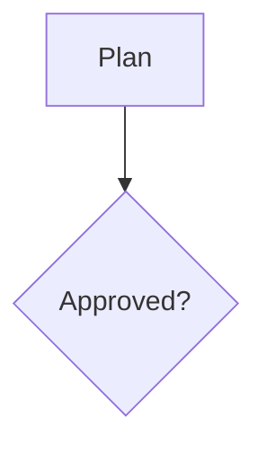
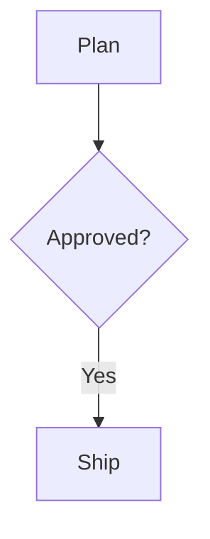

# The artifacts.space Markdown dialect

Markdown is the stored format of a Markdown artifact. Agents read and write
it over MCP, people edit it in the rich editor, and the read view, the
public page, the Markdown version (`.md`), and the link preview text all
draw it. This file gives the exact Markdown form of every block, so all of
them agree.

The base is GitHub-flavored Markdown (GFM). The editor parses it with
[marked](https://marked.js.org) through `@tiptap/markdown`; the read view
renders it with `react-markdown` and `remark-gfm`. Where the two could
disagree, the editor keeps the source as written (see "Raw blocks").

## Rules for every block

1. **It has one Markdown form.** Standard GFM where one exists. New blocks
   use, in order of preference: GFM, GitHub alerts (`> [!NOTE]`),
   `<details>`, image syntax with options in the URL fragment (media), then
   fenced blocks or `:::` directives.
2. **It round-trips.** Markdown loaded into the editor and saved without an
   edit comes back byte for byte. Rendered fresh (after an edit), it keeps
   its meaning: parsing the fresh Markdown gives the same editor content.
   `markdown-roundtrip.test.ts` checks both for every sample in
   `block-corpus.ts`.
3. **Every surface draws it.** The read view (`markdown-view.tsx`), the
   public page, the Markdown version (`src/lib/markdown`), and the link
   preview text (`src/lib/og/text-utils.ts`).
4. **Agents learn it** from `artifacts_formats_guide`
   (`src/lib/mcp/format-tools.ts`).
5. **Unknown syntax is never lost.** Anything the editor cannot show stays a
   raw block with its exact source.

## Blocks

| Block | Markdown form | Editor node |
| --- | --- | --- |
| Paragraph, bold, italic, strike, code, links | GFM | `paragraph` and marks |
| Headings 1–6 | `#` to `######` (setext `===` reads too, and is kept as written) | `heading` |
| Bulleted, numbered, and task lists | `-`, `1.`, `- [ ]` / `- [x]` | `bulletList`, `orderedList`, `taskList` |
| Quote | `>` | `blockquote` |
| Code block | Fenced with backticks, an optional language, and optional attributes in braces (below). The fence is one longer than any fence inside; tildes when the info string holds a backtick. | `codeBlock` |
| Mermaid diagram | A code block fenced as `mermaid`, with an optional view (below) | `codeBlock` with language `mermaid` |
| Table | GFM pipe table with optional alignment | `table` |
| Divider | `---` | `horizontalRule` |
| Media: image, video, audio, PDF, file | Image syntax alone in its paragraph (below) | `media` |
| Block colors on a paragraph or heading (also in lists and quotes) | A color comment at the end of its text (below) | `color` and `background` attributes |
| Anything else | As written | `rawMarkdown` |

### Media

An uploaded file shows in a document as image syntax, alone in its
paragraph: a blank line (or the start or end of the document) before and
after it.

```md


```

- **The URL** is the site-relative path `/api/files/<file id>`, where the id
  is the file's UUID. That route checks access on every request, so a media
  block never shows a file to someone who may not read it. Write it
  relative: the Markdown version makes link, image, and reference-definition
  targets absolute for readers outside the site (fenced and indented code
  blocks, also inside list items and quotes, and inline code, stay as
  written), and a save turns this site's own absolute file URLs back
  into the relative form (`absoluteFileLinks` and `relativeFileLinks`).
- **Options** follow `#`, joined with `&`, each at most once:
  - the kind: `video`, `audio`, `pdf`, or `file`. Leave it out for an image;
    `#image` reads as an image too, but is not written. When a URL names no
    kind, the read view shows the file as its type calls for (a video plays,
    a PDF opens; `shownMediaKind`).
  - `width=<10–100>`: a whole percent of the text column. Images and video
    only. Phones always use the full column. Without it, an image shows at its
    own size, never wider than the column.
  - When options are written, the kind comes first, then the width.
- **The text in brackets** is the alt text of an image, and the name shown
  for every other kind. It is plain text: Markdown punctuation in it is
  escaped with `\`, and an alt text with formatting or HTML character
  references stays a raw block.
- **The title** (`"…"`) is the caption, on one line. `"` and `\` in it are
  escaped with `\`. Single-quoted and parenthesized titles read too.
- **External images** (``) become media blocks that never
  load. Images from other sites could track readers, so the read view shows
  their alt text and the editor shows a notice. Upload the image instead.
- **What stays as written (a raw block):** an image inside a line of text or
  with text on the next line, an image inside a list item, a URL with a query
  string or an unknown option, a relative path that is not `/api/files/`,
  and alt text with formatting. The read view still draws an upload inside
  text as an inline image.
- **Uploads attach on save.** Saving Markdown that names your own finished
  uploads attaches them to the artifact (`checkContentFiles` in
  `src/lib/files/attach.ts`); links to files you cannot use stay plain links
  that load only for people who may read those files. Every `/api/files/<id>`
  in the text counts, media and plain links alike (`markdownFileRefs`). The
  save reads the files the author may use, not the linked ids, so the
  author's own uploads are always found however many links come first, and
  the 50-file cap applies only to usable files, so many links never fail a
  save or a Restore.
- **Only documents hold media.** A ui artifact's Markdown block is text only:
  no media in its slash menu, and a pasted or dropped file is refused with a
  note, because ui saves attach only Image and File block files. Media
  already written in such a block stays as written. Full media in ui Markdown
  blocks is a later phase.
- **Content media and plain attachments.** A file a content save attached
  (the save named the editor's own upload, so the save attached it) is
  content media: `artifact_file.attached_by_content` (set by
  `attachFileRows`; see `src/lib/files/content-files.ts`). A file attached any
  other way (`files_attach`, the Files panel) is a plain attachment, even if
  content links it later. So is every file attached before the column
  existed: nothing records how those came in.
- **Access follows the artifact.** People who can read the artifact can load
  its media. Readers of the approved version (outside the team) load only
  files attached by that version's time, and never content media the
  approved version does not show (`served-images.ts`). Being content media
  is kept on the file row, so it holds after pruning deletes the versions
  that showed it. Plain attachments are never hidden this way.
- **Removed media is kept for Restore, then deleted.** A save that drops an
  embedded file always files its own version, so Restore brings it back
  (`dropsShownImage`). While only older versions name content media, it does
  not count toward the 20-file limit (`countHistoryOnlyFiles`); once no
  version names it, history pruning deletes it (`pruneUnusedContentFiles` in
  `src/lib/files/icon-cleanup.ts`). The row is deleted in one statement that
  checks the artifact's current content, icon, and cover, and every
  version's, again, so a save
  that has just written content naming it keeps it; then its R2 object goes.
  A file attached in the last five minutes is never deleted, because a save
  attaches its uploads just before it writes the content that names them. Plain
  attachments are never deleted this way.

The rules are in `src/lib/files/media-rules.ts` (URL form, kinds, widths) and
`media-markdown.ts` (the block both ways).

### Code block attributes

A fenced code block can end its opening line with attributes in braces,
after the language:

````md


```ts {caption="The answer, typed" wrap=true}
const answer: number = 42;
```
````

- **Form:** a space, then `{`, then `key=value` pairs separated by spaces,
  then `}` as the last thing on the line. A value is a bare word, or
  double-quoted with `\"` and `\\` escaped. Rules are in
  `src/lib/markdown/fence-info.ts`.
- **`view`** (mermaid blocks only): how the block shows, to every reader.
  `preview`, the default, shows the diagram; `code` shows only the source as
  a code block, and never loads Mermaid; `split` shows both, the source
  first. Split is side by side when the block is at least 36rem wide and
  stacked (source above diagram) when it is narrower, so phones and narrow
  panes stack. The editor writes no `view` for Preview, and drops `view`
  when a diagram turns into another language (caption, wrap, and unknown
  keys stay).
- **`caption`** (any code block): one line of plain text shown under the
  block. Empty captions are dropped. A caption with a backtick makes the
  editor write a tilde fence, since a backtick fence's info string cannot
  hold one.
- **`wrap=true`** (any code block): long lines wrap instead of scrolling
  sideways.
- **Unknown keys and values are kept and ignored.** `{view=sideways}` shows
  the default view, and a block that does not parse (an open quote, text
  after the `}`) is ignored whole. Editing a block keeps every attribute it
  does not change, as written.
- **The language comes first.** Other renderers, such as GitHub, read the
  first word as the language, so a mermaid block with attributes still draws
  there. A block with attributes and no language is written with `text`.
- **Read as written.** Both Markdown parsers decode backslash escapes in the
  info string, so the editor reads the fence line from the token's source
  (`markdown-schema.ts`) and the read view from the document's source
  (`remark-fence-info.ts`), never the decoded `lang` or `meta`.
- **In the editor**, every code block has a toolbar along its top
  (`code-block-toolbar.tsx`): the language picker on the left; Copy, Wrap
  code, and Caption on the right. Caption opens a one-line field under the
  block that saves on Enter or when it loses focus.
- **Stored** in the `codeBlock` node's `language` attribute: the whole info
  string as written, so it round-trips byte for byte. Copy and paste keeps it
  through `data-info`.

### Mermaid diagrams

A fenced code block whose language is `mermaid` draws as a diagram:

````md

````

- **Detection** is the first word of the info string, in any case
  (`isMermaidLanguage` in `src/lib/markdown/mermaid-fence.ts`). Backtick and
  tilde fences both count.
- **The Markdown is the fenced block.** It stays a `codeBlock` node with
  language `mermaid`, so it round-trips like any code block and agents read
  and write the source as text. Its view and caption are fence attributes
  (above). Nothing else is stored.
- **Drawing** uses the mermaid format's renderer and security settings
  (`src/components/artifact-view/use-mermaid-diagram.ts` and
  `mermaid-render.ts`: securityLevel `strict`, no HTML labels, shown as an
  ``), so nothing in a diagram can run. Mermaid loads only when a page
  has a diagram to draw (never for the Code view), each diagram draws only
  as it nears the viewport (renders run one at a time), and it redraws for
  light, dark, and the artifact's theme. Screen readers get the source as
  text after the image, or from the code block beside it in Split.
- **Zoom:** a click on a drawn diagram, or its Zoom in button, opens it
  larger in a dialog.
- **A diagram that cannot be drawn** shows a short note ("Couldn’t draw this
  diagram.") and its source as an ordinary code block, never an empty space.
- **The read view** (`MarkdownView` with `diagrams`) shows each block in its
  view, with its caption, in Markdown artifacts, a file artifact's notes, and
  a ui artifact's Markdown block. Comments keep them as code.
- **The editor** (`mermaid-block-view.tsx`) shows the block in its view, with
  a toolbar: the language picker and the view picker (Code, Preview, Split)
  on the left; Copy, Wrap code, and Caption on the right, shown on hover and
  focus and always on touch screens. Picking a view saves it in the fence.
  Split's diagram redraws once typing pauses. In Preview, the source shows
  beside the diagram while the cursor is in it, and while the diagram is
  empty or broken, so it can be fixed. The slash menu's "Mermaid diagram"
  inserts an empty one, and "Mermaid diagram" in the language picker turns
  any code block into one, or back.
- **The Markdown version** keeps the fenced source. **Link previews** skip
  it like any code block.

### Block colors

A paragraph or heading can have a text color, a background, or both. They
are a block attribute, written as an HTML comment at the end of the line's
text:

```md
Ship it on Friday <!-- color: red -->

## Open questions <!-- background: yellow -->

- [ ] Call the venue <!-- color: blue; background: gray -->

> Quoted and shaded <!-- background: green -->
```

- **Hues:** `gray`, `brown`, `orange`, `yellow`, `green`, `blue`, `purple`,
  `pink`, `red` (`blockHues` in `src/lib/block-colors/block-color-rules.ts`).
  Each is a pair of tokens in `globals.css`, `--block-<hue>` for text and
  `--block-<hue>-bg` for backgrounds, with light and dark values. Any text
  color can sit on any background, so every text hue reads at WCAG AA on
  the page, a card, and every hue's background, and body text reads at AA
  on every background (`block-color-tokens.test.ts`). An artifact theme
  derives its own pairs from the same hues (`blockColorTokens` in
  `src/lib/themes/derive.ts`): each background tints the theme's card and
  stays visibly apart from it, and each text color is re-lit to keep the
  same guarantee on the theme's surfaces. The one limit: on a card within
  0.03 lightness of white or black, under body text close to 4.5:1 there,
  a background can only sit as far off the card as the body text allows,
  which is less than on other cards, and on the card itself when the body
  text is right at 4.5:1. A line with a background and no text color is drawn in the
  body text color, even in a quote or a small heading that is otherwise
  muted, so it stays readable on its background.
- **The comment** holds `name: value` declarations split by `;`. `color` is
  the text color and `background` the background. The editor writes
  `<!-- color: <hue>; background: <hue> -->`, color first, with the
  default left out, and no comment at all for a line with no colors.
- **Why a comment:** it stays inside the block, so a colored line is still
  one block for the round trip, and every other Markdown reader (GitHub,
  editors, agents' renderers) hides it. Rule 1's forms all show up as text
  or structure in plain GFM; a color should not.
- **What colors:** the comment must be the last thing in a paragraph's or
  heading's text (only spaces may follow it). A list item's colors are those
  of its first line (items nested under it keep their own). In the block
  menu, Color on a quote colors every line in it; code blocks, tables,
  dividers, media, and raw blocks have no Color.
- **Unknown hues and names are ignored:** a color comment that names
  `color` or `background` with a value that is not a hue colors nothing
  (`<!-- color: teal -->`), and unknown names in it are ignored. Loading
  keeps it as written, but once that line is edited, the editor writes only
  the colors it knows, so the comment is removed (or rewritten without the
  unknown parts). Any other comment, or a color comment in the middle of
  text, is raw HTML: the block stays a raw block, as written.
- **An empty line** cannot keep colors: with no text, the comment would
  start the line and turn it into an HTML block.
- **Surfaces:** the editor sets `data-block-color` and
  `data-block-background` on the paragraph or heading
  (`block-color-nodes.ts`); the read view does the same
  (`remark-block-colors.ts`), on a span around the line for the first line
  of an item in a tight list, which has no `<p>`. The Markdown version keeps
  the comment as written, and link preview text leaves it out.

### Raw blocks

A top-level block the editor cannot show as formatted text, or that would
not survive a round trip, loads as a `rawMarkdown` node holding its exact
source. It shows as an editable source box and saves unchanged. Today that is
raw HTML, footnotes, link reference definitions, images inside text, and any
block whose fresh rendering would change its meaning.

## Block node conventions

Every block is built so real-time co-editing (Yjs, later) needs no rewrite:

- **All state is in the document.** A node's attributes and content are plain
  JSON (strings, numbers, booleans, null). No DOM nodes, `File` objects,
  functions, or dates in attributes.
- **The Markdown comes only from the node.** `renderMarkdown` reads attributes
  and content and nothing else. A node that cannot be written yet (an empty
  or uploading media block) renders `""`, and the serializer leaves it out.
- **Transient state lives outside the document.** Upload progress, open menus,
  and drag previews live in React state or in a registry keyed by an
  attribute (`media-uploads.ts`, keyed by `uploadId`).
- **System updates skip the undo history.** When the editor, not the person,
  changes a node (an upload finishing), it dispatches with
  `addToHistory: false`, so Undo never puts a block back into a state that
  can no longer finish.
- **Attributes are read defensively.** Node views read attributes through a
  reader (such as `readMediaAttrs`) that falls back to safe values, since a
  collaborator or an old document may send anything.
- **Copy and paste inside the editor** keeps the node through `renderHTML` and
  `parseHTML` with `data-` attributes.
- **One view draws both sides.** The read view and the editor share the
  drawing component (`MediaBlock` in `src/components/artifact-view`); the
  editor adds only editing controls around it.

## Adding a block

1. Choose its Markdown form by the order in rule 1, and add it to the table
   above with its options.
2. Write the node in `src/components/editor/rich/` following the conventions,
   with a `markdownTokenizer` when marked does not already produce a token for
   it, and register it in `markdown-schema.ts`.
3. Add samples to `block-corpus.ts`, including forms that must stay raw. Run
   `pnpm test`.
4. Draw it in `markdown-view.tsx`, and check the Markdown version and the
   link preview text.
5. Explain it in `artifacts_formats_guide`.
